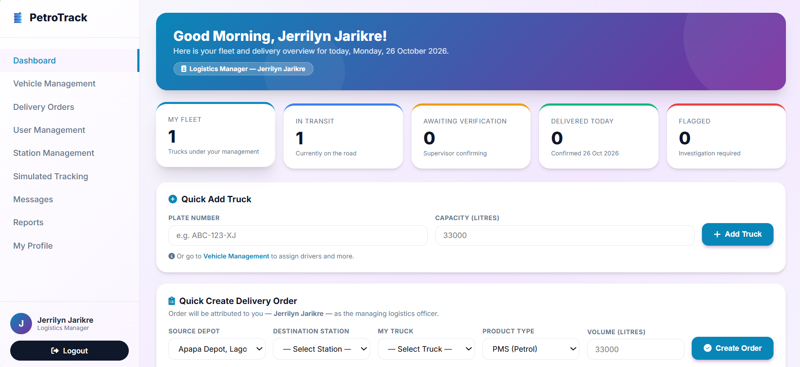
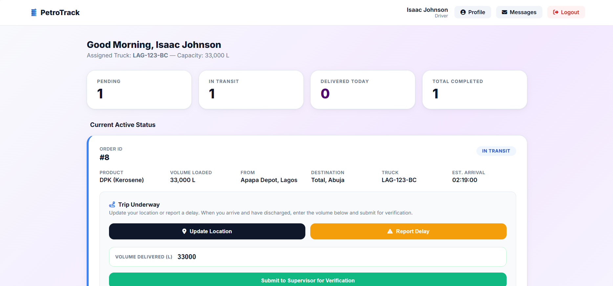
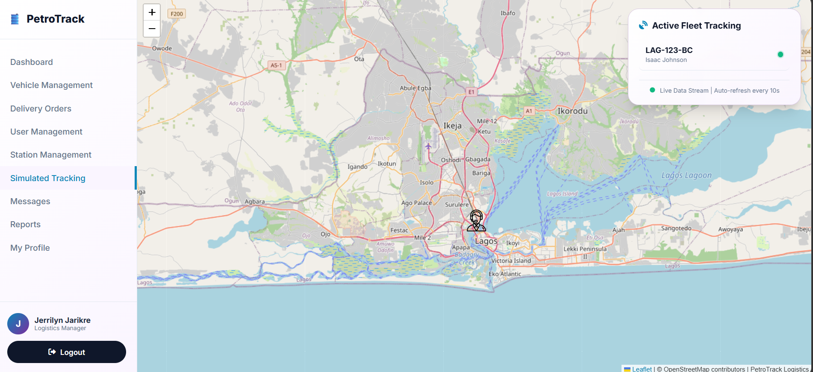
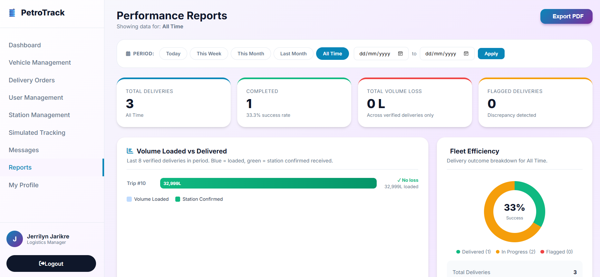

# PetroTrack

PetroTrack is a web-based application for tracking petroleum deliveries from the depot to the filling station. I built it as my final year project in Computer Science at Edo State University Iyamho, supervised by Dr. J.O. Nehinbe.

It tracks fuel deliveries from depot to filling station, verifies delivered volumes at the station, and flags losses and discrepancies.

## Screenshots

**Admin dashboard (Logistics Manager)**



**Driver dashboard**



**Live fleet map (simulated GPS)**



**Performance reports with PDF export**



## Features

- **Role-based access** for three roles: Admin (logistics manager), Driver and Station Supervisor
- **Delivery management**: create, assign and update deliveries (PMS, AGO, DPK, ATK)
- **Vehicle management**: add trucks, assign or unassign drivers, deactivate trucks
- **Delivery verification**: drivers report the delivered volume, supervisors confirm it with a PIN and a station dip reading; variances over 100 L are flagged and the driver is suspended pending investigation
- **Live map**: fleet tracking with Leaflet.js and OpenStreetMap (GPS positions are simulated, see below)
- **Reports**: volume loss summaries with PDF export (TCPDF)
- **Messaging** between users, user and station management, profile page
- **Password recovery** using a security question, with attempt lockout

## Tech stack

PHP 8.2, MariaDB / MySQL, HTML, CSS, JavaScript, Leaflet.js, TCPDF, Font Awesome 6 (CDN). No PHP framework.

## Setup (XAMPP)

1. Install XAMPP and start Apache and MySQL.
2. Copy this folder into `htdocs` as `petrotrack`.
3. Open phpMyAdmin, click Import, and choose `database/petroleum_logistics_db.sql`. This creates the `petroleum_logistics_db` database with demo data.
4. Check `config/db_connect.php` (defaults: host `localhost`, user `root`, empty password).
5. Open `http://localhost/petrotrack/`.

## Demo accounts

| Role | Email | Password |
|---|---|---|
| Admin | admin@petrotrack.demo | Admin@1234 |
| Supervisor (Coinoil, Ikeja) | supervisor@petrotrack.demo | Super@1234 |
| Driver | driver@petrotrack.demo | Driver@1234 |

Supervisor verification PIN: `1234`. Security question answer (all demo users): `blue`.

## Roles and account creation

PetroTrack has three roles: Admin (Logistics Manager), Driver and Station Supervisor.

- Drivers and supervisors can register themselves on the register page.
- The Admin role cannot be chosen at registration. If it could, anyone could sign up as a manager and gain full control of the fleet, deliveries and reports.
- The first admin is seeded in the database (see the demo accounts above). Every later admin is created by an existing admin in User Management.
- If no admin exists, one can be promoted directly in the database:

```sql
UPDATE users SET role = 'admin' WHERE email = 'your@email.com';
```

## Security notes

- Passwords are stored as bcrypt hashes.
- Session ID is regenerated on login, and every page checks the user's role before loading.
- Destructive actions such as deleting a vehicle use POST requests, and vehicles with delivery history are deactivated instead of deleted so records are preserved.
- Password recovery locks for 10 minutes after 5 wrong answers and does not reveal whether an email is registered.

## GPS simulation

Real GPS hardware is outside the scope of this project. Truck positions on the map are simulated with `simulate_truck.php` (admin login required), which moves a truck along a route so the tracking flow can be demonstrated.

## Author

Osajarikre Jerrilyn Isoken
